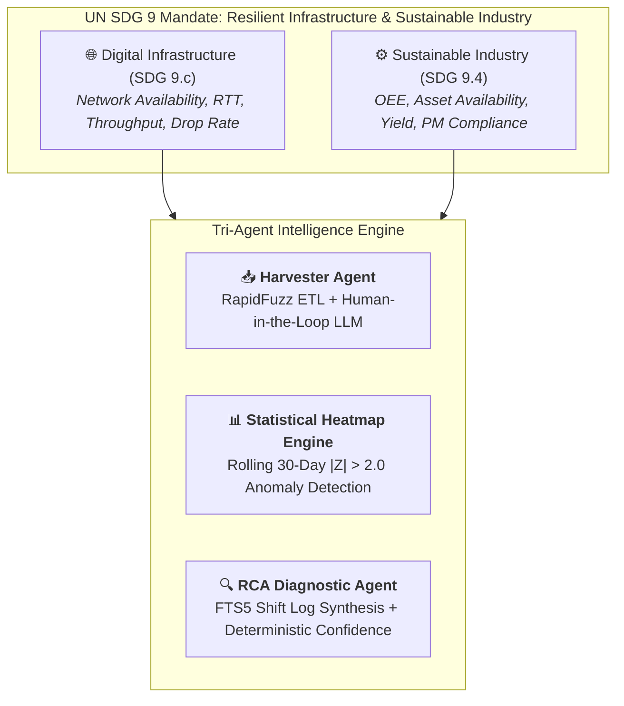

# OmniKPI — Agentic Infrastructure & Industrial Intelligence

> **Empowering UN SDG 9: Industry, Innovation, and Infrastructure**  
> *A Tri-Agent AI platform for real-time statistical anomaly detection, operational resilience, and root cause diagnosis across critical infrastructure and sustainable industrial ecosystems.*

---

## 🌍 Strategic Alignment: UN SDG 9

Modern socioeconomic progress relies on the stability of two interdependent backbones: **Digital Communications Infrastructure (Target 9.c)** and **Resource-Efficient Industrial Manufacturing (Target 9.4)**. When operational disruptions occur, cross-departmental KPI silos slow down response times, leading to service blackouts, equipment degradation, and wasted energy.

OmniKPI addresses this challenge through a universal, archetype-based KPI intelligence system:



---

## 🌟 Core Innovations

### 1. Universal 5-Archetype KPI Ontology
Rather than hard-coding siloed metrics, OmniKPI organizes all performance indicators into five structural archetypes derived from international standards (**ISO 22400** and **TM Forum**):

| Archetype | Focus Area | Key Indicators | Standard Alignment |
|---|---|---|---|
| **Availability** | Operational uptime & access | Network Availability, Pump Uptime, BTS Accessibility | ISO 22400 / TM Forum |
| **Performance** | Throughput & resource efficiency | Data Throughput, Ethylene Yield, Compressor Efficiency | ISO 22400 / Industry |
| **Quality** | Defect rates & error integrity | Packet Loss, Scrap Ratio, First-Pass Yield, Call Drops | ISO 22400 / TM Forum |
| **Reliability** | Mean failure & repair horizons | MTBF, MTTR, PM Compliance Rate | ISO 22400 / TM Forum |
| **Composite** | Holistic system health | OEE (Overall Equipment Effectiveness) | ISO 22400 |

### 2. Tri-Agent Architecture
- **Harvester Agent**: Ingests disparate Excel telemetry reports. Matches headers via RapidFuzz ($>80\%$ confidence) with LLM interpretation fallback.
- **Statistical Heatmap Engine**: Calculates rolling 30-day $Z$-scores to dynamically identify statistical deviations ($|Z| > 2.0$) while suppressing false alarms for low-sample datasets.
- **RCA Diagnostic Agent**: Grounds root cause synthesis in actual operational shift logs retrieved via SQLite FTS5. Computes a **deterministic confidence score** ($88\%–96\%$) directly from $Z$-score magnitude and corroborating log counts (never hallucinated by an LLM).

### 3. Industrial Safety Boundary (ISA-95 Level 3)
In strict compliance with industrial safety principles, OmniKPI operates as a **Level 3 MOM/MES advisory intelligence platform**. It delivers actionable diagnostic insights for certified engineers without issuing automated Level 1/2 control commands.

---

## 🏗️ Technical Stack

- **Backend**: FastAPI (Python 3.11+), SQLAlchemy 2.x, SQLite with FTS5 virtual tables, RapidFuzz, Pandas, AsyncOpenAI.
- **Frontend**: Pure React SPA (Vite, TailwindCSS v4, Recharts, Glassmorphism design system).
- **Database Schema**: Multi-tenant Star Schema with domain isolation and recursive CTE adjacency list for infinite location hierarchies.

---

## 🚀 Quick Start

### 1. Backend Setup
```bash
cd backend
python -m pip install -r requirements.txt
cp .env.example .env
python seed_data.py
python -m uvicorn main:app --reload --port 8000
```

### 2. Frontend Setup
```bash
cd frontend
npm install
npm run dev
```
Open **`http://localhost:5173`** to access the dashboard.

---

## 📄 License & Disclaimer

All datasets, location labels, and shift logs contained in this repository are **100% synthetically generated** for demonstration, academic, and research purposes.
