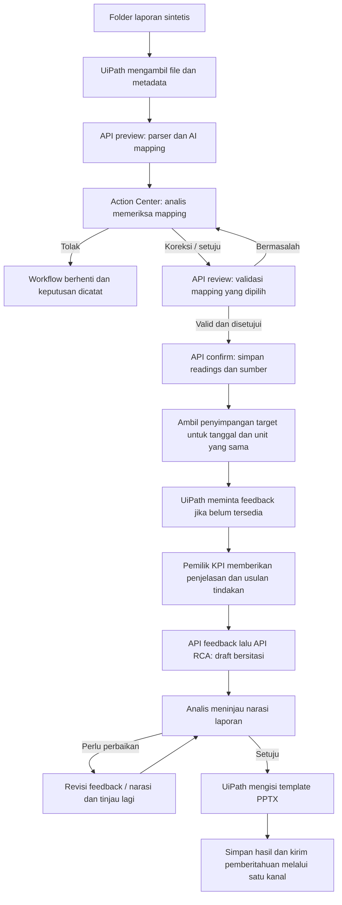

# VantageNet — konteks produk dan rencana eksekusi

**Diperbarui:** 16 November 2026

**Kompetisi:** Indosat & UiPath Automation Hackathon 2026

**Tema:** Human in the Lead

**Deadline pengumpulan:** 25 November 2026, 23.59 WIB

**Status:** fondasi aplikasi tersedia; integrasi UiPath adalah pekerjaan MVP yang direncanakan, belum diklaim selesai.

Dokumen ini adalah pegangan bersama untuk produk dan kontrak kerja tim. Baca juga
[role Lazuardi](ROLE_LAZUARDI.md), [role Faizh](ROLE_FAIZH.md), dan
[handoff teknis aplikasi lama](../handoff.md).

## 1. VantageNet itu apa?

VantageNet adalah platform otomasi pelaporan kinerja telco. Produk ini menghubungkan
laporan divisional, interpretasi kolom berbasis AI, validasi manusia, konsolidasi,
permintaan feedback, dan penyusunan laporan manajemen.

VantageNet adalah nama baru omniKPI. Nama folder, database, endpoint, dan beberapa
label kode masih memakai omniKPI; ini tidak berarti ada dua produk berbeda.
Penggantian seluruh nama teknis bukan prasyarat MVP kompetisi.

**Janji produk:** laporan masuk melalui robot, angka masuk ke dataset setelah
ditinjau, dan laporan manajemen keluar setelah isinya disetujui manusia.

## 2. Masalah dan pengguna

Ide berasal dari pengalaman magang pemilik proyek di fungsi Performance & Support
Network Infranexia. Laporan KPI berbagai unit diterima dalam file terpisah, kemudian
dikompilasi sebelum analisis dan pelaporan kepada stakeholder.

Pekerjaan yang dituju adalah pengumpulan, penyamaan makna kolom, pengecekan angka,
penelusuran sumber, dan pengumpulan penjelasan dari pemilik KPI. Belum ada pengukuran
waktu kerja atau penghematan yang boleh diklaim sebagai hasil produk.

| Pengguna | Kebutuhan |
|---|---|
| Analis performance | Menggabungkan laporan, menilai penyimpangan, dan menyiapkan laporan yang dapat diperiksa |
| Pemilik KPI di divisi | Menyerahkan angka serta feedback yang terhubung ke KPI, lokasi, dan tanggal yang tepat |
| Stakeholder | Memahami kondisi kinerja dan sumber penjelasannya |

Rani adalah **persona ilustratif** untuk menjelaskan pekerjaan analis. Pengambilan
langsung dari NMS Huawei/Ericsson adalah skenario pengembangan, bukan integrasi
yang sudah dibuktikan. MVP memakai folder input dengan data sintetis.

## 3. Pembagian tanggung jawab

| Bagian | PIC | Tanggung jawab utama |
|---|---|---|
| UiPath / robot | **Lazuardi** | Mengambil file, memanggil API, membuat tugas manusia, menunggu hasilnya, melanjutkan proses, notifikasi, dan mengisi template PPTX |
| Backend / AI / integrasi | **Faizh** | API dan layanan data, AI mapping/RCA, validasi, provenance, kontrak robot, data laporan, dan dukungan UI yang diperlukan |
| Product / QA / pitch | **Belum ditetapkan namanya** | Menentukan skenario, expected output, menguji alur, menyediakan template, deck, video, dan pemeriksaan submission |

Lazuardi menentukan bagaimana pekerjaan berjalan di UiPath. Faizh menjaga arti dan
kebenaran data serta kontrak API. Perubahan kontrak dibahas berdua sebelum dipakai;
robot tidak membuat versi kalkulasi KPI sendiri.

## 4. Alur yang ingin dicapai

Empat fase untuk menjelaskan produk: **Kumpulkan → Tinjau → Investigasi → Laporkan**.



Jika feedback sudah ada, workflow boleh langsung meminta draft RCA. Jangan
memeragakan feedback bawaan fixture seolah baru ditulis manusia saat demo.
Jika tidak ada penyimpangan target, laporan tetap dapat dibuat tanpa RCA yang dipaksakan.

### Dua kontrol manusia

1. **Sebelum import:** analis dapat mengubah atau menolak mapping. Mapping yang
   diteruskan ke backend adalah hasil koreksinya.
2. **Sebelum laporan final:** analis dapat menolak atau memperbaiki draft narasi.
   Robot menggunakan versi yang sudah disetujui.

Approval pada workflow UiPath belum berarti API backend memiliki enforcement
approval atau autentikasi pengguna. Endpoint lama masih dapat dipanggil langsung;
batas ini harus dinyatakan jika ditanya tentang keamanan produksi.

## 5. Yang tersedia dan yang masih harus dibuat

| Kemampuan | Status berdasarkan kode lokal |
|---|---|
| Upload XLSX/CSV, header bertingkat, AI mapping dan alasan per kolom | Tersedia |
| Review mapping, validasi, confirm dan penolakan duplikasi | Tersedia |
| Dataset KPI, history, target status dan sumber file/baris/unit | Tersedia |
| Feedback per reading dan draft RCA dengan referensi | Tersedia |
| Landing, workspace, light/dark mode dan demo sintetis | Tersedia |
| Robot pengambil file dan integrasi HTTP UiPath | Direncanakan; belum ditemukan project UiPath di repo saat penyusunan dokumen |
| Action Center untuk mapping dan approval laporan | Direncanakan; akses tenant/package harus dibuktikan |
| Notifikasi dan pencegahan pengiriman berulang | Perlu dibuat |
| Snapshot laporan dan generator laporan operasional PPTX | Perlu disepakati/dibangun |
| Pencatatan keputusan workflow dan keterkaitan task dengan submission | Perlu dibuat |
| Update dashboard otomatis setelah robot mengimpor data | Belum real-time; gunakan refresh eksplisit atau polling terukur jika diperlukan |

Script deck kompetisi di `output/` atau `.deck-*` bukan generator laporan
operasional yang sudah terintegrasi ke aplikasi.

## 6. Batas MVP sampai deadline

### Must-have

- Satu sumber input: folder lokal/shared folder sintetis yang dapat diakses robot.
- Satu file berhasil melewati robot → review manusia → review API → confirm.
- Koreksi mapping benar-benar memengaruhi payload dan hasil import.
- Penolakan manusia serta data invalid menghentikan import.
- Satu skenario feedback/RCA dan review narasi yang selesai.
- Satu template PPTX dengan angka, konteks sumber, dan narasi yang disetujui.
- Satu kanal pemberitahuan, misalnya email ke penerima uji yang disepakati.
- Project robot, README, data contoh, expected output, deck dan video dapat dibuka.

### Should-have setelah alur inti bekerja

- File kedua dengan layout berbeda; lalu pemrosesan tujuh file jika sudah stabil.
- Pencatatan run/task/approval dan pemulihan proses yang gagal.
- Penyimpanan bersama atau upload hasil ke satu tujuan yang sudah punya koneksi.

### Ditunda

Login NMS vendor, WhatsApp + Slack sekaligus, banyak konektor penyimpanan,
redesign frontend besar, model ML baru, forecasting, dan automatic remediation.

Jika Action Center tidak dapat digunakan, tim menentukan alternatif human-review
yang benar-benar berjalan dalam runtime UiPath yang tersedia. Catat perubahan
arsitektur dan tampilkan nama mekanisme sebenarnya; jangan menyebutnya Action Center.

## 7. Kontrak integrasi yang sudah ada

Pilih satu **base URL** yang benar-benar dapat dijangkau runtime robot. Contoh
lokal `http://127.0.0.1:8000` hanya berlaku jika robot berjalan pada mesin tersebut.
Cloud robot tidak otomatis dapat mengakses localhost laptop pengembang.

Untuk uji robot, Faizh menyiapkan **database uji terpisah dan disposable**. Gunakan
workspace normal `/app` pada backend uji itu. Hindari `/app?demo=1` dan `/api/demo/seed`
untuk membuktikan hasil import robot, karena keduanya dapat menyiapkan data otomatis.

Prefix produk untuk MVP: `/api/v1/domains/1`.

| Langkah | Method dan endpoint | Kontrak utama |
|---|---|---|
| Identitas uji | `GET /_development/instance` | Status `disposable`, `instance_id`, `domain_id`, `app`, `database` (tanpa secret) |
| Cek server | `GET /api/v1/health` | Liveness; bukan bukti provider AI dapat dipakai |
| Cek AI | `GET /api/v1/ai/status` | Konfigurasi live/model tanpa key; bukan pengganti satu panggilan AI nyata |
| Interpretasi | `POST /api/v1/domains/1/submissions/preview` | Multipart: file, division, report_date, sheet_name, header_row, header_depth |
| Validasi | `POST /api/v1/domains/1/submissions/{submission_id}/review` | JSON: mapping hasil review manusia dan default_direction jika diperlukan |
| Import | `POST /api/v1/domains/1/submissions/{submission_id}/confirm` | JSON yang sama dengan versi mapping yang baru lolos review |
| Ledger | `GET /api/v1/domains/1/submissions` | Submission yang sudah confirmed |
| Detail & rekonsiliasi | `GET /api/v1/domains/1/submissions/{submission_id}` | Status submission (`draft`/`confirmed`), `mapping`, `fingerprint`, dan daftar `readings` beserta `fact_id` dan provenance |
| Data laporan | `GET /api/v1/domains/1/heatmap?dataset=submitted&date=2026-06-30` | Filter date/division sesuai run; jangan memakai data latest tanpa sengaja |
| Shortfall | `GET /api/v1/domains/1/anomalies?dataset=submitted&date=2026-06-30` | Reading gagal target; respons berisi fact_id, KPI, lokasi, tanggal dan division |
| Baca feedback | `GET /api/v1/domains/1/feedback?fact_id={fact_id}` | Mengambil daftar feedback exact-fact beserta `origin` (`fixture-worksheet-notes` vs `operator-api`) |
| Feedback | `POST /api/v1/domains/1/feedback` | JSON: fact_id, explanation, corrective_action (mengembalikan `feedback_id`, `reference`, `origin: "operator-api"`) |
| Draft RCA | `POST /api/v1/domains/1/rca` | JSON: kpi_id, location_id, fact_id |
| Bundle laporan (1-reading) | `POST /api/v1/domains/1/report-bundles` | JSON: `submission_id`, `fact_id`, `bundle_id`, `revision`; menghasilkan bundle konsisten `vantagenet.report-bundle` `schema_version: 2` (`source_kind: "backend-read-bundle"`), atau CLI `backend/export_report_bundle.py` |

**Perbedaan bentuk mapping:** respons preview berisi objek per kolom, misalnya
`column_mapping["Realisasi"].target`. Request review/confirm memerlukan dictionary
`nama kolom -> string field`, bukan seluruh objek preview.

Contoh bentuk request review/confirm untuk fixture ED:

```json
{
  "mapping": {
    "KPI WISA": "kpi_name",
    "SATUAN": "unit",
    "FORMULA": "higher_is_better",
    "TGT": "target_value",
    "Lokasi": "location_name",
    "Realisasi": "actual_value",
    "Keterangan": "notes"
  },
  "default_direction": null
}
```

Ini contoh struktur kontrak, bukan instruksi untuk selalu mengirim mapping yang
hardcoded. Robot harus mengirim hasil yang disetujui manusia. Jika mapping berubah
setelah validasi, lakukan review lagi sebelum confirm.

Contoh bentuk feedback dan RCA, dengan ID ilustratif yang harus diganti hasil API:

```json
{
  "fact_id": 123,
  "explanation": "Contoh sintetis: akses lokasi ditunda menurut laporan divisi.",
  "corrective_action": "Konfirmasi jadwal akses yang telah direvisi."
}
```

```json
{ "kpi_id": 12, "location_id": 3, "fact_id": 123 }
```

`/confirm` dapat mengembalikan HTTP 409; kesalahan parsing/review dapat berupa 422;
kegagalan provider dapat berupa 503. HTTP 200 pada `/review` tetap harus diperiksa
isi `can_confirm`, `issues`, dan `conflicts`-nya.

Kontrak export PPTX langsung atau penyimpanan status approval Action Center di sisi backend belum diimplementasikan. Untuk batas data laporan 1-reading, backend kini menyediakan `GET /api/v1/domains/1/submissions/{submission_id}`, `GET /api/v1/domains/1/feedback?fact_id={fact_id}`, `POST /api/v1/domains/1/report-bundles`, dan CLI `backend/export_report_bundle.py` (`schema_version: 2`, `source_kind: "backend-read-bundle"`); detail implementasi dan catatan admission ada di [FAIZH_BACKEND_HANDOFF.md](FAIZH_BACKEND_HANDOFF.md). Adapter UiPath saat ini (`AdaptReportBundle.cs`) baru menerima `schema_version: 1` (`source_kind: "synthetic-fixture"`) dan masih memerlukan ekstensi terpisah di sisi UiPath untuk menerima `schema_version: 2`.

## 8. Data, AI dan aturan yang tidak boleh berubah

- **AI:** interpretasi kolom dan draft penjelasan dari feedback. Keduanya memakai
  model pretrained; tidak ada model baru yang dilatih untuk MVP ini.
- **Deterministik:** parsing, validasi, duplikasi, kalkulasi target, penyimpanan,
  provenance dan statistik. UiPath memakai hasil backend, bukan menghitung ulang.
- **Merah:** gagal target. Endpoint `/anomalies` saat ini mengembalikan shortfall
  target; jangan menyebut semua item sebagai insiden statistik atau keadaan darurat.
- **Z-score:** sinyal terpisah yang membutuhkan histori. Fixture satu tanggal
  tidak membuktikan deteksi statistik atau forecasting.
- **RCA:** tanpa feedback menghasilkan `awaiting_feedback` tanpa panggilan model.
  Model juga dapat mengembalikan `insufficient_evidence` setelah dipanggil.
- Provider gagal, konfigurasi hilang, atau sitasi tidak valid harus terlihat sebagai
  kegagalan. Jangan mengganti diam-diam dengan teks non-AI atau output rekaman.
- Sitasi `[F1]` memeriksa identitas referensi, bukan membuktikan penyebab benar.
- Rani tetap memutuskan; robot tidak melakukan perubahan konfigurasi jaringan.

Fixture publik ada di `frontend/public/demo/divisions/`. Worksheet `Report`, header
row 4, depth 1, tanggal 2026-06-30. Unit ED berbeda dari nama worksheet.

| Cakupan | KPI | Readings |
|---|---:|---:|
| ED | 13 | 26 |
| MBB | 17 | 34 |
| Seluruh tujuh file | 90 | 180 |

Total tujuh file: 7 unit, 2 lokasi fiktif, 121 readings memenuhi target dan 59 belum.
Angka tersebut adalah **data demo sintetis**, bukan hasil operasional Infranexia
atau akurasi AI. Jika robot hanya mengimpor ED, bukti import robot adalah 26 readings,
bukan 180 hasil seed sebelumnya.

ED sudah memiliki feedback sintetis di fixture. MBB dapat dipakai untuk menguji
skenario belum ada feedback; periksa reading yang dipilih melalui API.
Jangan memakai workbook konsolidasi privat WISA sebagai satu file milik satu divisi.

## 9. Jejak workflow minimum yang direncanakan

Simpan keterkaitan `run_id`, hash/nama file input, division, report_date,
submission_id, task ID, keputusan reviewer, mapping yang disetujui, fact_id terpilih,
referensi feedback, versi narasi yang disetujui, dan path hasil.

Field ini adalah kebutuhan integrasi yang disepakati, **belum seluruhnya tersedia
dalam skema backend**. Untuk MVP boleh memakai manifest run JSON atau penyimpanan
workflow yang disepakati, tanpa menyimpan key/password atau data privat di log.

Jika confirm mengalami timeout, periksa hasil melalui mekanisme rekonsiliasi yang
disepakati sebelum mengulang write. Menjalankan ulang file yang sama tidak boleh
menggandakan readings, notifikasi, atau laporan final.

## 10. Jadwal dan checkpoint

| Tanggal | Checkpoint tim |
|---|---|
| 16–17 Nov | Satu file melewati robot, tugas manusia, koreksi mapping, review API dan confirm |
| 18–19 Nov | File kedua/layout lain; penolakan, invalid data, duplikasi dan kegagalan provider tertangani |
| 20–21 Nov | Feedback/RCA dan review narasi tersambung; keputusan reviewer tercatat |
| 22 Nov | Template PPTX menghasilkan laporan dari data serta narasi yang disetujui; **feature freeze** |
| 23 Nov | Uji ulang dari kondisi awal, pemulihan error, dan jalankan oleh anggota lain |
| 24 Nov | Finalisasi deck, rekam video, kemas ZIP source project dan README |
| 25 Nov | Buffer perbaikan dan pengumpulan lebih awal dari 23.59 WIB |

Jika checkpoint 17 November tidak tercapai, kurangi konektor, jumlah file dan
kerumitan form bersama PIC produk. Pertahankan satu alur UiPath yang benar-benar
selesai dan kontrol manusia yang nyata.

## 11. Definition of done dan submission

- [ ] Robot memproses input baru, bukan hanya membuka workspace yang sudah di-seed.
- [ ] Reviewer dapat mengubah atau menolak mapping; keputusan berpengaruh pada alur.
- [ ] Invalid data dan duplikasi tidak menambah readings.
- [ ] Angka dan sumber cocok dengan reference fixture untuk file yang benar-benar diproses.
- [ ] Feedback/RCA terikat ke reading yang dipilih; error dan bukti tidak cukup terlihat.
- [ ] Laporan memakai cakupan tanggal/unit serta narasi yang disetujui.
- [ ] PPTX terbuka, terbaca dan sesuai template; hasil terhubung ke run asalnya.
- [ ] Tidak ada credential/data rahasia dalam source ZIP, data contoh, log, atau video.
- [ ] Anggota lain dapat menjalankan dengan README dan akses yang disebutkan.
- [ ] Pitch deck `.pptx`, source project + README/data contoh `.zip`, video `.mp4` maksimal 100 MB siap.

Aturan deadline dan format berasal dari
[dokumen kickoff, hlm. 9–11](<../Documents/Kick Off Automation Hackathon 2026.pdf>).
Dokumen asli bersifat lokal dan bisa tidak ada di clone baru; simpan ringkasan
persyaratan ini dalam paket kerja tim.

Referensi teknis untuk implementasi: [Action Center](https://docs.uipath.com/action-center/automation-cloud/latest/user-guide/introduction),
[Wait For Form Task And Resume](https://docs.uipath.com/activities/other/latest/workflow/wait-for-form-task-and-resume),
[PowerPoint activities](https://docs.uipath.com/activities/other/latest/productivity/about-the-presentations-activities-pack).
Kesesuaian tenant, versi package, dan runtime perlu dibuktikan pada lingkungan tim.
