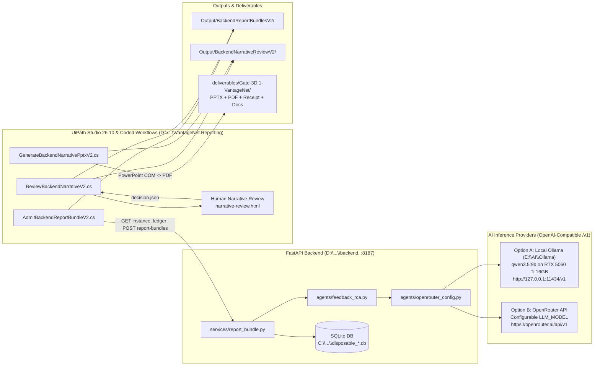

# VantageNet / OmniKPI — Gate 3D.1–3D.4 Technical Handover

- **Deliverables Directory**: `D:\myProject\OmniKP-integration\deliverables\Gate-3D.1-VantageNet`
- **Repository**: `D:\myProject\OmniKP-integration`
- **Branch / HEAD**: `feature/vantagenet-live-v2-integration` @ `fc1e811acaea4e46d863afc315557f8ca5835990`
- **Disposable Acceptance Instance**: `vantagenet-acceptance-20261121-e63c` (`sqlite:disposable_vantagenet_acceptance_20261121_e63c.db`)

---

## 1. System Architecture & Drive Responsibilities

### Storage Layout Across Drives

| Drive | Role | Verified Paths |
|---|---|---|
| **`C:\`** | Windows 11 OS, UiPath Studio/CLI installation, local Python acceptance venv, launcher, and disposable SQLite DB | - UiPath Studio: `C:\Program Files\UiPathPlatform\Studio\26.10.0-cloud.25715\UiPath.Studio.exe`<br>- UiPath CLI: `C:\Program Files\UiPathPlatform\Studio\26.10.0-cloud.25715\cli\uip.cmd`<br>- Acceptance Launcher: `%LOCALAPPDATA%\VantageNet\start-acceptance-backend.ps1`<br>- Acceptance Python Venv: `%LOCALAPPDATA%\VantageNet\acceptance-venv\Scripts\python.exe`<br>- Disposable DB: `C:\Users\Windows 11\AppData\Local\Temp\vantagenet-acceptance-20261121-e63c\disposable_vantagenet_acceptance_20261121_e63c.db` |
| **`D:\`** | Git worktree repository, FastAPI backend, UiPath coded workflows, outputs, and final deliverables | - Repository Root: `D:\myProject\OmniKP-integration`<br>- Backend: `D:\myProject\OmniKP-integration\backend`<br>- UiPath Project: `D:\myProject\OmniKP-integration\automation\uipath\VantageNet.Reporting`<br>- Deliverables: `D:\myProject\OmniKP-integration\deliverables\Gate-3D.1-VantageNet` |
| **`E:\`** | Dedicated local AI runtime, model weights, and Ollama server logs | - Ollama Binaries: `E:\AI\Ollama\ollama.exe`<br>- Model Storage (`OLLAMA_MODELS`): `E:\AI\Models`<br>- Server Logs: `E:\AI\Logs\ollama-server.stdout.log`, `E:\AI\Logs\ollama-server.stderr.log` |

### Component Architecture Diagram



### Component Communication & Responsibilities
1. **AI Provider Layer (`openrouter_config.py`)**: Instantiates `AsyncOpenAI` pointing to either Local Ollama (`http://127.0.0.1:11434/v1`) or OpenRouter (`https://openrouter.ai/api/v1`).
2. **FastAPI Backend (`backend/main.py`, `routers/submissions.py`, `services/report_bundle.py`, `agents/feedback_rca.py`)**: Reads confirmed KPI facts and exact-fact division feedback in a single SQLite `SELECT`, releases the DB connection, invokes the configured LLM for RCA drafting, validates JSON schema/framing/citations fail-closed, and returns a versioned `vantagenet.report-bundle` v2 JSON payload.
3. **UiPath Admission (`AdmitBackendReportBundleV2.cs`)**: Verifies backend instance identity, confirmed ledger, reading SHA-256 digest, and narrative grounding, then atomically writes `bundle.json`, `state.json`, and `snapshot.json`.
4. **Human Narrative Review (`ReviewBackendNarrativeV2.cs`)**: Generates `request.json` and `narrative-review.html` for attended human sign-off, then validates and archives `decision/decision.json` and `decision/result.json`.
5. **PPTX Generation & Deliverables (`GenerateBackendNarrativePptxV2.cs`)**: Verifies the recorded `approve` decision and pinned template (`provisional-report-template.pptx`), populates 3 slides, validates XML text parity, and writes the PPTX + `generation-receipt.json`. PowerPoint COM automation exports `report-proof.pdf`.

---

## 2. Dual AI Provider Configuration

### Environment Variable Precedence (`backend/agents/openrouter_config.py`)
`openrouter_config.py` calls `dotenv.load_dotenv()` (default `override=False`) and reads three variables:
- `OPENROUTER_BASE_URL` (default: `"https://openrouter.ai/api/v1"`)
- `OPENROUTER_API_KEY` (default: `""`)
- `LLM_MODEL` (default: `"meta-llama/llama-3.1-70b-instruct"`)
- `OPENROUTER_MAX_RETRIES` (optional nonnegative integer; if unset, `AsyncOpenAI` uses SDK default `2`)

**Precedence Order (highest to lowest):**
1. **Explicit process environment variables** (e.g., set by `%LOCALAPPDATA%\VantageNet\start-acceptance-backend.ps1` via `$start.EnvironmentVariables[...]` or set in the PowerShell session before launching `uvicorn`). Because `load_dotenv()` defaults to `override=False`, process environment variables always win over `backend\.env`.
2. **`backend\.env` file** (loaded if the variable is not already set in the process environment).
3. **Code defaults in `openrouter_config.py`**.

> **Important Launcher Note**: `%LOCALAPPDATA%\VantageNet\start-acceptance-backend.ps1` currently sets `OPENROUTER_BASE_URL="http://127.0.0.1:11434/v1"`, `LLM_MODEL="qwen3.5:9b"`, `OPENROUTER_API_KEY="ollama-local"`, and `OPENROUTER_MAX_RETRIES="0"` directly on the child `uvicorn` process. To run the acceptance backend against OpenRouter without modifying `start-acceptance-backend.ps1`, launch `uvicorn` directly with OpenRouter environment variables (shown in Option B below) or update `$providerUrl` / `$model` / `$credential` prompt in a separate launcher copy.

---

### Option A — Local AI (Ollama) [Live-Verified in Gate 3D.1V7]

- **Runtime**: Ollama for Windows `0.40.17` (`E:\AI\Ollama`)
- **Model**: `qwen3.5:9b` (`56671c2ab938`, `Q4_K_M`, `6.101 GiB` stored in `E:\AI\Models`)
- **GPU**: NVIDIA GeForce RTX 5060 Ti 16GB (`100% GPU` offload, `5.9 GB` resident VRAM)
- **Endpoint**: `http://127.0.0.1:11434/v1`
- **Local API Key**: `ollama-local` (non-secret dummy credential; `openrouter_config.py` also strips any accidental `sk-or-*` key and substitutes `ollama-local` when `OPENROUTER_BASE_URL` is a loopback URL)
- **Context / Concurrency**: `OLLAMA_CONTEXT_LENGTH=8192`, `OLLAMA_NUM_PARALLEL=1`, `OLLAMA_FLASH_ATTENTION=1`, `temperature=0`, `"reasoning_effort": "none"` injected automatically by `_prepare_local_ollama_request()` in `openrouter_config.py`.

1. **Start Ollama**:
   ```powershell
   $env:OLLAMA_MODELS = "E:\AI\Models"
   $env:OLLAMA_NUM_PARALLEL = "1"
   $env:OLLAMA_CONTEXT_LENGTH = "8192"
   $env:OLLAMA_FLASH_ATTENTION = "1"
   $env:OLLAMA_HOST = "127.0.0.1:11434"
   E:\AI\Ollama\ollama.exe serve
   ```
2. **Verify Model Installed**:
   ```powershell
   $env:OLLAMA_MODELS = "E:\AI\Models"
   E:\AI\Ollama\ollama.exe list
   ```
3. **Warm Up the Model** (recommended so cold disk load ~55s does not hit the 25s RCA request timeout):
   ```powershell
   $warmBody = @{
       model = "qwen3.5:9b"; stream = $false; think = $false; keep_alive = "30m"
       options = @{ temperature = 0; num_predict = 8; num_ctx = 8192 }
       messages = @(@{ role = "user"; content = "ping" })
   } | ConvertTo-Json -Depth 6 -Compress
   Invoke-RestMethod -Uri "http://127.0.0.1:11434/api/chat" -Method Post -ContentType "application/json" -Body $warmBody
   ```
4. **Verify GPU Offloading & VRAM**:
   ```powershell
   E:\AI\Ollama\ollama.exe ps
   nvidia-smi --query-gpu=name,utilization.gpu,memory.total,memory.used,memory.free --format=csv,noheader
   ```
5. **Configure & Start Backend for Ollama**:
   ```powershell
   powershell.exe -NoLogo -NoProfile -ExecutionPolicy Bypass -File "$env:LOCALAPPDATA\VantageNet\start-acceptance-backend.ps1"
   ```
6. **Switch from Ollama to OpenRouter**: Stop the backend (`Stop-Process -Id <pid>`), then start `uvicorn` with `OPENROUTER_BASE_URL="https://openrouter.ai/api/v1"`, your chosen `LLM_MODEL`, and a user-provided `OPENROUTER_API_KEY` (see Option B).

---

### Option B — OpenRouter API (Remote Cloud Provider)

> **Verification Status**: OpenRouter integration is implemented in `backend/agents/openrouter_config.py` and verified by offline unit tests (`backend/test_openrouter_config.py`). Live OpenRouter inference was **not** re-run in Gate 3D.1–3D.4 (prior `v5`/`v6` free-tier attempts returned HTTP 429).

- **Base URL**: `https://openrouter.ai/api/v1`
- **Authentication**: User-provided `OPENROUTER_API_KEY`
- **Model**: Configurable via `LLM_MODEL` (never hardcode a single model; example OpenRouter model IDs can be selected from https://openrouter.ai/models).

1. **Obtain an API Key**: Sign in at https://openrouter.ai/ and create a key under **Keys** (`sk-or-v1-...`).
2. **Configure Securely (Never Hardcode or Print)**:
   - **Option 1 — Interactive PowerShell (`SecureString`, zero disk persistence)**:
     ```powershell
     $sec = Read-Host -Prompt "Enter OpenRouter API key" -AsSecureString
     $bstr = [Runtime.InteropServices.Marshal]::SecureStringToBSTR($sec)
     try {
         $env:OPENROUTER_API_KEY = [Runtime.InteropServices.Marshal]::PtrToStringBSTR($bstr)
     } finally {
         [Runtime.InteropServices.Marshal]::ZeroFreeBSTR($bstr)
         $sec.Dispose()
     }
     $env:OPENROUTER_BASE_URL = "https://openrouter.ai/api/v1"
     $env:LLM_MODEL = "<provider/model-id>"   # e.g., meta-llama/llama-3.1-70b-instruct or paid/free model
     $env:OPENROUTER_MAX_RETRIES = "0"
     ```
   - **Option 2 — Protected `backend\.env`** (`.env` is gitignored; restrict NTFS ACLs to the current user):
     ```ini
     OPENROUTER_BASE_URL=https://openrouter.ai/api/v1
     OPENROUTER_API_KEY=<your-openrouter-key>
     LLM_MODEL=<provider/model-id>
     OPENROUTER_MAX_RETRIES=0
     ```
3. **Start Disposable Acceptance Backend with OpenRouter** (without echoing the key):
   ```powershell
   $env:DATABASE_URL = "sqlite:///C:/Users/Windows 11/AppData/Local/Temp/vantagenet-acceptance-20261121-e63c/disposable_vantagenet_acceptance_20261121_e63c.db"
   $env:DEMO_DATABASE_URL = "sqlite://"
   $env:VANTAGENET_DISPOSABLE = "1"
   $env:VANTAGENET_DISPOSABLE_INSTANCE_ID = "vantagenet-acceptance-20261121-e63c"
   Push-Location D:\myProject\OmniKP-integration\backend
   & "$env:LOCALAPPDATA\VantageNet\acceptance-venv\Scripts\python.exe" -B -E -s -m uvicorn main:app --host 127.0.0.1 --port 8187 --workers 1 --lifespan off --log-level warning --no-access-log
   ```
4. **Verify Configuration Without Exposing the API Key**:
   ```powershell
   Invoke-RestMethod http://127.0.0.1:8187/api/v1/ai/status | Select-Object configured,mode,model,provider,max_retries
   ```
   Confirm `configured : True`, `mode : live`, `provider : https://openrouter.ai/api/v1`, and `model` matches your chosen `LLM_MODEL`. (`ai_status()` never returns `OPENROUTER_API_KEY`.)
5. **Switch from OpenRouter Back to Local Ollama**:
   Stop the OpenRouter backend process, clear `OPENROUTER_API_KEY` from the shell (`Remove-Item Env:OPENROUTER_API_KEY -ErrorAction SilentlyContinue`), ensure Ollama is running, and launch `%LOCALAPPDATA%\VantageNet\start-acceptance-backend.ps1`.
6. **Handling OpenRouter Errors**:
   - **HTTP 401 (`AuthenticationError`)**: Invalid/revoked `OPENROUTER_API_KEY` — re-enter a valid key.
   - **HTTP 402 (`APIStatusError`)**: Insufficient OpenRouter credits — top up credits or switch to Local Ollama.
   - **HTTP 429 (`RateLimitError`)**: Free-tier or upstream rate limit — wait or switch to Local Ollama (note `OPENROUTER_MAX_RETRIES=0` fails closed without hidden retries).
   - **HTTP 404 / 5xx (`NotFoundError` / `InternalServerError`)**: Model unavailable or provider outage — select another model ID in `LLM_MODEL` or switch to Local Ollama.

### Provider Comparison

| Feature | Local Ollama | OpenRouter |
|---|---|---|
| Inference location | Local GPU | Cloud |
| Authentication | Dummy local key (`ollama-local`) | Real API key (`OPENROUTER_API_KEY`) |
| Internet requirement | Not required for inference | Required |
| Cost | Local hardware/electricity | Model/API pricing |
| Model selection | Installed local models (`qwen3.5:9b`) | Available OpenRouter models (`LLM_MODEL`) |
| Privacy | Local inference | Requests sent to provider |
| GPU requirement | Yes (RTX 5060 Ti 16GB) | No |

**When to prefer each**: Use **Local Ollama** for offline/air-gapped demos, deterministic zero-rate-limit acceptance runs, and data privacy. Use **OpenRouter** when no local GPU is available or when evaluating larger frontier cloud models.

---

## 3. UiPath Studio Operating Guide

- **Studio GUI Executable**: `C:\Program Files\UiPathPlatform\Studio\26.10.0-cloud.25715\UiPath.Studio.exe`
- **UiPath CLI**: `C:\Program Files\UiPathPlatform\Studio\26.10.0-cloud.25715\cli\uip.cmd` (`UiPath CLI 1.205.0`)
- **Project File**: `D:\myProject\OmniKP-integration\automation\uipath\VantageNet.Reporting\project.json` (`projectId`: `a5ddfe29-5288-4542-85a4-72e9a6156a5d`, `targetFramework`: `Windows`, `dotNetVersion`: `net10.0`)

### Coded Workflows & Helper Classes
- **Entry Points** (declared in `project.json` `entryPoints`, marked with `[Workflow] public string Execute(...)`):
  1. `AdmitBackendReportBundleV2.cs` — Inputs: `projectFolder`, `backendOrigin`, `domainId`, `expectedInstanceId`, `expectedDatabase`, `submissionId`, `factId`, `bundleId`, `revision`.
  2. `ReviewBackendNarrativeV2.cs` — Inputs: `projectFolder`, `bundleId`, `revision`, `decisionPath` (optional; omit for Prepare, supply for Record).
  3. `GenerateBackendNarrativePptxV2.cs` — Inputs: `projectFolder`, `bundleId`, `revision`.
- **Supporting C# Modules** (compiled together as part of the project, not standalone entry points): `BackendBundleV2Admission.cs`, `BackendBundleV2Contract.cs`, `BackendBundleV2Digest.cs`, `BackendNarrativeV2.cs`, `NarrativeState.cs`, `OperatorFeedbackAcceptance.cs`.

### Opening, Building, and Running in UiPath Studio GUI
1. Launch `C:\Program Files\UiPathPlatform\Studio\26.10.0-cloud.25715\UiPath.Studio.exe`.
2. Select **Open a Local Project** and open `D:\myProject\OmniKP-integration\automation\uipath\VantageNet.Reporting\project.json`.
3. In the **Project** panel, locate `AdmitBackendReportBundleV2.cs`, `ReviewBackendNarrativeV2.cs`, or `GenerateBackendNarrativePptxV2.cs`.
4. To build/validate, use **Design** ribbon -> **Analyze File** / **Validate Project** (or run `uip.cmd rpa build` via terminal).
5. To run a Coded Workflow in Studio: open the `.cs` file, open **Debug File** dropdown -> **Run File** (or **Run**), and supply the exact input arguments in the Studio arguments prompt/panel.
6. Execution artifacts are written under `D:\myProject\OmniKP-integration\automation\uipath\VantageNet.Reporting\Output\`.

### Running via `uip.cmd` CLI
```powershell
$uip = "C:\Program Files\UiPathPlatform\Studio\26.10.0-cloud.25715\cli\uip.cmd"
$proj = "D:\myProject\OmniKP-integration\automation\uipath\VantageNet.Reporting"

# Build once after any .cs edit
& $uip rpa build --project-dir $proj --profile "vantagenet-local-noauth" --output json

# Run a workflow (example: AdmitBackendReportBundleV2.cs for a NEW revision v8)
& $uip rpa run --project-dir $proj --file-path "AdmitBackendReportBundleV2.cs" --profile "vantagenet-local-noauth" --skip-build --output json `
  --input-arguments "projectFolder=$proj" --input-arguments "backendOrigin=http://127.0.0.1:8187" --input-arguments "domainId=1" `
  --input-arguments "expectedInstanceId=vantagenet-acceptance-20261121-e63c" --input-arguments "expectedDatabase=sqlite:disposable_vantagenet_acceptance_20261121_e63c.db" `
  --input-arguments "submissionId=aff04920-b5ee-4ddd-9786-9c94a7549d35" --input-arguments "factId=12" --input-arguments "bundleId=gate3d-ed-fact12" --input-arguments "revision=v8"
```
> **Never rerun `revision=v7`**: `v7` is an immutable, completed acceptance revision. Use a new revision (e.g., `v8`) or a new `bundleId` for future demonstrations.

---

## 4. Gate 3D.1–3D.4 Acceptance Evidence

| Artifact | Path / Scope | SHA-256 |
|---|---|---|
| **V7 Bundle** | `Output/BackendReportBundlesV2/case-gate3d-ed-fact12/v7/bundle.json` | `55e8d472244a20c7e19e096eb33aaef68dd1d43a488463d66e8d6b80e5480145` |
| **V7 State** | `Output/BackendReportBundlesV2/case-gate3d-ed-fact12/v7/state.json` | `141419e9f839d4b21c329f919d71da1999a052712031641ebc441be1575bccc9` |
| **V7 Snapshot** | `Output/BackendReportBundlesV2/case-gate3d-ed-fact12/v7/snapshot.json` | `b22c255110c73ddc5197d469ed48886fd6fda251ed3d27afa8cad9700d77bdf7` |
| **Reading Digest** | `producer.reading_sha256` | `c6cb648dd7eef82cf0f1fb05c74d2deb8bec57678b7f2ee421836cf506fa7eac` |
| **Approved Narrative** | Proposal 1 (`narrative_sha256 == reviewed_narrative_sha256`) | `7d855b52a36abfa441c8778db6332fc348510df607b6eec39c5fc495594292d5` |
| **Approval Decision** | `Output/BackendNarrativeReviewV2/case-gate3d-ed-fact12/v7/decision/decision.json` | `bb3f52e7bbac8fb955c88cd9ece8aef74e81b79a175f404ada3fb1910248f7db` |
| **Final PPTX** | `VantageNet-gate3d-ed-fact12-v7.pptx` (`31,903` bytes) | `e90556b7be294b55f8c69cfaf1cc76db132038db660aeda6a272c722ff153a80` |
| **PDF Proof** | `report-proof.pdf` (`97,473` bytes, 3 pages) | `413a4f5745e847094c51daa1b4564b02def6dec1d39cacbd9099418f2a82c519` |
| **Generation Receipt** | `generation-receipt.json` (`1,518` bytes) | `ff757b0820eb89b7296e2d6f63677637c3dee3cb5667c2121bc5b9887c70ff58` |
| **Pinned Template** | `Data/provisional-report-template.pptx` | `ca657e395364e44fc731e1803aedf3a828ad2fa6d2ca996a06c1ecd1127eb0a8` |
| **Disposable DB** | `disposable_vantagenet_acceptance_20261121_e63c.db` | `2ba26669f2eea8825fe86cf2b013daf165e4312f6ce30ecee713ea9c559093cf` |
| **RCA Validator** | `backend/agents/feedback_rca.py` | `68d30b118594915846907a090cd48b48a1a7e2cf3634adffd5bf0bc1bf6a2b72` |

- **Tests**: Backend offline regression `43/43` passed (`test_openrouter_config`, `test_ai_revision`, `test_demo`, `test_product_flow`); UiPath Narrative v2 regression `18/18` passed (`Tests/test_backend_narrative_v2.py`).
- **Historical & Git Integrity**: `v1`–`v6` bundles/states and Gate 3C (`11` files) intact; Git branch `feature/vantagenet-live-v2-integration` @ `fc1e811acaea4e46d863afc315557f8ca5835990` preserved.

---

## 5. Known Limitations & Production-Readiness Gaps

1. **Synthetic Acceptance Data Only**: Fact `12` / Feedback `F6` (`DEP-WHF-Deployment Alpro`, `Demo South`, `546 Port` vs `600 Port`) is a labelled hypothetical test scenario (`SYNTHETIC ACCEPTANCE SCENARIO`), not verified operational telemetry.
2. **Cold-Load Latency**: Initial cold load of `qwen3.5:9b` from `E:\AI\Models` takes ~55s, exceeding `feedback_rca.py`'s `timeout=25`. Pre-warm the model before live RCA calls.
3. **VRAM Contention**: `qwen3.5:9b` (`8192` context) uses ~`5.9 GB` VRAM; concurrent heavy GPU applications can constrain memory or throughput.
4. **Launcher Hardcoding**: `start-acceptance-backend.ps1` pins Local Ollama (`http://127.0.0.1:11434/v1`); switching to OpenRouter requires launching `uvicorn` with OpenRouter environment variables as documented in Section 2B.
5. **Production Security**: Acceptance runs on `127.0.0.1` loopback without authentication or TLS and uses a provisional 3-slide template. Production deployment requires auth, TLS, persistent DB backups, and operational feedback governance.
