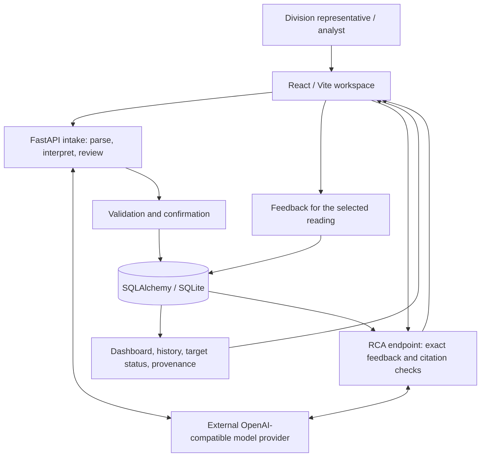

# omniKPI project handoff

Last reviewed: **10 November 2026**. This describes the local checkout at commit
`a3d3638` on `main`. The remote is `https://github.com/Llovind/OmniKP.git`; remote
changes and any hosted deployment were not checked for this handoff.

## 1. What omniKPI is

omniKPI is an **AI-assisted performance reporting workspace for telecom teams**.
It brings divisional Excel/CSV submissions into a shared KPI dataset, checks
readings against their targets, preserves where each number came from, and drafts
explanations from feedback supplied by the responsible division.

The product promise is:

> Submit a division report, review how its columns were interpreted, confirm its
> readings, and investigate performance with the original sources still attached.

It is a working competition prototype with a product interface. It is not yet a
production data platform, a network monitoring system, or a proven commercial SaaS.

## 2. Why it exists

The founder's motivation comes from a Performance & Support Network internship at
**Infranexia**. The team received KPI reports from different network functions,
including Mobile Broadband, Fiber Connectivity, and Core Network. The supervisor
manually collected Excel extracts and compiled a consolidated workbook before
analyzing shortfalls and presenting performance to stakeholders.

The main friction was the work **before analysis**: collecting scattered files,
reconciling column labels, combining readings, and retaining enough context to ask
the right division why a KPI missed its target.

The product therefore starts with divisional reporting and consolidation. RCA is
an investigation aid after the data is organized, not a substitute for that core
workflow. The division supplies the explanation; AI helps draft it with references.

The internship account is the origin of the idea. It does not establish company
endorsement, deployment, a formal user study, or measured productivity gains.

## 3. Who it is for

| Person | Job to be done | What omniKPI provides |
|---|---|---|
| Performance analyst / Performance & Support team | Assemble reports, review KPI performance, prepare explanations | Reviewed consolidation, target checks, source attribution, and investigation |
| KPI owner / division representative | Submit measurements and explain a specific shortfall | Report intake and feedback linked to an exact reading |
| Manager / stakeholder | Understand performance and question its supporting evidence | A shared view with a path back to the submitting unit and source |

**Rani**, used in the pitch, is an illustrative performance-analyst persona. She is
not a named interview respondent or customer. Division identity is currently
selected in the interface; it is not verified through user accounts.

## 4. The product workflow

1. **Submit:** choose a division, reporting date, file, worksheet, and header settings.
2. **Interpret and review:** the live model proposes column meanings with reasons;
   the analyst checks and corrects them.
3. **Validate and confirm:** deterministic checks reject invalid/conflicting data;
   confirmation writes valid readings and provenance to the database.
4. **Investigate:** review the combined dashboard, select a reading, attach division
   feedback, and request an attributed AI draft for human review.

A **KPI** is an indicator definition. A **reading** is a measurement for one KPI,
location, and reporting date. This is why the main demo has 90 KPIs but 180 readings:
each KPI has a reading at each of two locations for the same reporting date.

### What happens when a file is uploaded

- The parser reads one worksheet, resolves selected headers, and keeps source rows.
- Local aliases/fuzzy matching generate context for the model.
- Live AI interprets every column; saved mapping records do not bypass inference.
- A draft `Submission` stores parsed data and proposed mappings. This staging step
  already writes data locally, but it does not import readings into `fact_kpi`.
- Review normalizes records and reports issues and existing-reading conflicts.
- Confirm revalidates, claims the draft, creates the required dimensions/readings,
  records source attribution and applicable feedback, recomputes affected history,
  saves the confirmed mapping, and commits.

Normal UI use requires analyst review. The demo seed programmatically confirms its
synthetic fixture reports through the same services; it does not simulate a real
person approving them. Confirmation is not an authenticated approval audit trail.

## 5. Where the AI actually is

There are **two active AI responsibilities**, both using a pretrained model through
an OpenAI-compatible client. No custom model is trained in this repository.

### A. Schema interpretation

Implementation: [backend/services/intake.py](backend/services/intake.py).

- Input: exact headers, local-rule suggestions, and values from up to the first
  three data rows per column. Sample strings are truncated to 120 characters.
- Processing: columns are sent in batches of 60; the model proposes a field and a
  short explanation for each column.
- Output: meanings such as `kpi_name`, `actual_value`, `target_value`,
  `location_name`, `unit`, `higher_is_better`, `notes`, `ignore`, or
  `location:<name>` for wide actual-value columns.
- Example: `KPI WISA` -> `kpi_name`, `Realisasi` -> `actual_value`,
  `TGT` -> `target_value`.
- Controls: incomplete/invalid output or missing/unavailable provider returns an
  error; the analyst can correct a successful proposal before confirmation.
- The response exposes model/provider, batch and sample scope, reasons, and latency.
  A stored numeric `confidence` placeholder is not calibrated AI confidence.

The innovation is interpretation within the intake workflow: differing report
labels can be proposed as a common schema without forcing every unit to adopt the
same spreadsheet first. Generalization to arbitrary real reports is not proven.

### B. Feedback-linked RCA drafting

Implementation: [backend/agents/feedback_rca.py](backend/agents/feedback_rca.py),
called by [backend/routers/rca.py](backend/routers/rca.py).

- The selected fact identifies a KPI, location, and period. Feedback is retrieved
  by that exact `fact_id`, rather than nearby or unrelated operational logs.
- The model receives that reading's context and attached feedback, then returns an
  explanation, proposed action, and feedback references such as `[F1]`.
- No feedback: return `awaiting_feedback` / insufficient evidence without a model call.
- Feedback that the model judges insufficient: it can abstain after a model call.
- Missing provider, provider error, malformed output, or invalid/missing citations:
  return a visible error. There is no active non-AI draft fallback.
- Citation validation checks reference IDs and structure. It does **not** establish
  that the reported cause is true or that every sentence is semantically supported.
- The analyst remains responsible for judging the draft. No remediation is executed.

### What is deterministic

Parsing, normalization, validation, duplicate/conflict rejection, database writes,
target comparisons, attainment arithmetic, source attribution, and the Z-score
baseline are application logic. Do not label these as trained AI models.

The owner's established direction is an integrated, live-AI product. Do not restore
an AI opt-out, a rules-only demo mode, or silent replay/fallback as if it were live AI.
The legacy `use_ai` API field is accepted for compatibility but cannot disable AI.

## 6. Architecture and code ownership



| Area | Main files | Responsibility |
|---|---|---|
| Server entry / static hosting | `backend/main.py` | Router registration, startup tables/domain, CORS, built SPA serving |
| Schema and persistence | `backend/database.py` | SQLAlchemy models, engines, session dependencies |
| Intake | `backend/services/intake.py`, `backend/routers/submissions.py` | Parser, mapping, staging, review, confirm, feedback |
| Performance | `backend/services/performance.py`, `backend/routers/kpi.py`, `backend/routers/anomaly.py` | Target status, heatmap, history, statistical baseline |
| RCA | `backend/agents/feedback_rca.py`, `backend/routers/rca.py` | Evidence-scoped drafting and citation validation |
| Provider configuration / compatibility helpers | `backend/agents/harvester.py`, `backend/agents/rca_agent.py` | Client configuration; these also contain legacy experiments |
| AI status and benchmark | `backend/routers/ai.py`, `backend/benchmark_mapping.py` | Read-only runtime configuration and synthetic evaluation |
| Demo lifecycle | `backend/routers/demo.py` | Separate database, AI preparation, seed/reset |
| Frontend routes | `frontend/src/main.jsx`, `frontend/src/AppRoutes.jsx` | Theme startup, browser routing, lazy workspace/evaluation |
| Workspace | `frontend/src/App.jsx` | Filters, selections, upload, history, feedback/RCA coordination |
| Product components | `frontend/src/components/` | `HeatmapMatrix`, `HarvesterModal`, `RCAPanel`, `KPIDetailModal`, `Header`, `Dialog` |
| API boundary | `frontend/src/api/client.js` | Query encoding, normal/demo base URL, fetch wrappers |
| Landing and evaluation | `frontend/src/Landing.jsx`, `frontend/src/Evaluation.jsx` | Product explanation, demo preparation, mapping evidence |

Frontend: React 19, Vite 8, React Router, Tailwind 4, Recharts, Motion, and a lazy
Three.js landing effect. JSX and TSX coexist. `oxlint` and TypeScript provide checks.
Backend: Python, FastAPI, SQLAlchemy, SQLite, openpyxl, pandas/numpy, RapidFuzz, and
the OpenAI-compatible Python client. Exact dependencies are in lockfiles and
`backend/requirements.txt`; do not upgrade them as part of an unrelated UI change.

### Data model

| Table | Meaning |
|---|---|
| `dim_domain` | Active telecommunications domain; current UI uses domain 1 |
| `dim_kpi` | Indicator name, unit, direction, category and supporting definition |
| `dim_location` | Locations with optional parent hierarchy |
| `dim_period` | Reporting dates/periods |
| `fact_kpi` | Actual, target, target status, and statistical context |
| `submissions` | Staged/confirmed report, division, filename, worksheet, raw JSON and mapping |
| `reading_sources` | Reading-to-submission attribution, division and source row |
| `division_feedback` | Explanation and proposed action attached to an exact reading |
| `mapping_memory` | Retained mapping records; not a shortcut around live interpretation |
| `shift_logs` / FTS5 | Legacy retrieval experiment; not current division-feedback evidence |

`ReadingSource.fact_id` references `FactKPI`; `submission_id` references a
`Submission`. `DivisionFeedback.fact_id` references the same selected reading.
Domain validation is a data-scope check, **not user authentication or tenant security**.

## 7. URLs and API contracts

| URL | Purpose |
|---|---|
| `/` | Product landing page |
| `/app` | Normal workspace, using the normal database |
| `/app?demo=1` | Synthetic demo workspace, using the separate demo database |
| `/evaluation` | Synthetic schema-mapping benchmark |
| `/docs`, `/redoc` | Backend-generated API documentation |

Normal API base: `/api/v1`. Demo workspace base:
`/api/demo/workspace/api/v1`. Most product routes are scoped under
`/domains/{domain_id}`, currently domain `1`.

| Method | Path | Purpose |
|---|---|---|
| GET | `/api/v1/health` | Server liveness |
| GET | `/api/v1/ai/status` | Whether live AI is configured; model and provider, never the key |
| GET | `/api/v1/ai/evaluation` | Stored synthetic benchmark evidence |
| GET | `/api/v1/domains/1/heatmap` | Combined readings, status and provenance |
| GET | `/api/v1/domains/1/periods` | Available reporting dates |
| GET | `/api/v1/domains/1/submissions` | Confirmed report ledger |
| GET | `/api/v1/domains/1/kpis/{kpi_id}/history` | Location-scoped history; supports `as_of` |
| POST | `/api/v1/domains/1/submissions/preview` | Multipart upload and mandatory AI interpretation |
| POST | `/api/v1/domains/1/submissions/{submission_id}/review` | Validate the reviewed mapping |
| POST | `/api/v1/domains/1/submissions/{submission_id}/confirm` | Revalidate and import |
| POST | `/api/v1/domains/1/feedback` | Attach explanation/action to `fact_id` |
| POST | `/api/v1/domains/1/rca` | Draft from feedback for the selected reading |
| POST | `/api/demo/seed` | Prepare/reuse the isolated synthetic dataset |
| POST | `/api/demo/seed?reset=true` | Reinterpret and rebuild the synthetic demo |

The client computes its API base from the query string at module initialization.
Use a full reload when checking normal versus demo mode. Preserve this distinction
when changing navigation. Standard workspace responses are expected to contain
JSON; empty successful bodies such as HTTP 204 need explicit client handling.

## 8. Synthetic demo and validation pack

Inputs: [frontend/public/demo/divisions/](frontend/public/demo/divisions/).
Catalogue: [manifest.json](frontend/public/demo/divisions/manifest.json).

| Submitting unit | KPIs | Readings | Input |
|---|---:|---:|---|
| BGES & OLO | 41 | 82 | `bges-olo.xlsx` |
| MBB | 17 | 34 | `mbb.xlsx` |
| ED | 13 | 26 | `ed.xlsx` |
| NETOP OSP | 8 | 16 | `netop-osp.xlsx` |
| FBB | 8 | 16 | `fbb.xlsx` |
| AIM | 2 | 4 | `aim.xlsx` |
| DEFA | 1 | 2 | `defa.xlsx` |
| **Total** | **90** | **180** | **7 workbooks** |

- Date: **2026-06-30**. Locations: **Demo North** and **Demo South**.
- Expected status: **121 meeting target (67.2%)**, **59 missing target (32.8%)**.
- Fixture worksheet: **`Report`**, header row **4**, header depth **1**.
- Names, units, directions and ownership follow the June WISA consolidated
  workbook's **`SUB-UNIT REG BARU`** grouping. They do not reproduce every original
  organizational or geographic hierarchy.
- Measurements, targets, locations and feedback are synthetic. These are
  reconstructed inputs, not recovered original divisional templates or company results.
- `ED` is a submitting-unit code. `KPI WISA` is a source column containing KPI names.
  `Realisasi` / `REAL` means actual, `TGT` means target, and `ACH` means achievement.
  Official expansions of ED/WISA have not been verified; do not invent them.

**One-click path:** Try demo calls the seed endpoint. A cold seed interprets all
seven files live, then confirms them through the existing intake services. Repeated
opens reuse the prepared dataset; Reset demo reinterprets it. The workspace opens
the ED shortfall with synthetic feedback and automatically requests its AI draft.
Cold preparation can take time and incurs provider calls; it is not guaranteed to
finish in a few seconds. Landing/client preparation currently allow 180 seconds.

**Manual path:** open a clean normal workspace, use Upload report -> Division demo
workbooks, load each fixture's settings, review and confirm. Uploading these files
into an already populated demo correctly produces duplicate conflicts.

The normal database defaults to `backend/omnikpi.db`; the demo defaults to
`backend/omnikpi-demo.db`. Demo isolation separates it from normal imports, but it
is **shared by demo visitors**, not a private per-user sandbox. Reset affects that
shared synthetic dataset. Initial provider proposals are prepared before a reset
replaces the old demo; later confirmation can still fail and require recovery.

The validation pack includes `expected-consolidated.xlsx`, `expected-readings.json`,
`validation-summary.json`, checksums, and separate missing-value, duplicate-reading
and changed-header exercises. `backend/validate_demo_pack.py` calculates reference
results from fixture cells without calling the app's normalization/status helpers.
See [VALIDATE.md](frontend/public/demo/divisions/VALIDATE.md) and
[fixture provenance](backend/evidence/division-demo/README.md).

## 9. Import and performance rules to preserve

- `.xlsx` and UTF-8 CSV are supported; legacy `.xls` is not.
- One worksheet per upload; header row 1-50 or 0 for auto, with 1-3 header levels.
- The parser caps uploads at 10 MB, expanded XLSX content at 80 MB, approximately
  5,000 source data rows / 300 columns, and 10,000 normalized readings per submission.
- The old 80-column AI rejection was removed; model batches are 60 columns.
- Missing, non-finite, invalid, incompatible or duplicate data blocks confirmation.
  Do not silently import only the valid subset or replace existing readings.
- Worksheet names are not division names. The fixture tab is `Report`, not `ED`.
  Matching handles whitespace/case, and single-sheet files resolve to their sole tab.
- Known consolidated WISA outputs are rejected as single-unit submissions. A
  dedicated multi-unit adapter would be needed; do not attribute the whole file to ED.
- Excel percentage cells are normalized; formulas require cached values saved by a
  spreadsheet application. The server does not evaluate arbitrary workbook formulas.
- Row layouts support explicit location/actual/target columns. Wide actual columns
  map to locations; ACH columns are ignored. Location-specific targets should use rows.
- Higher-is-better meets target at `actual >= target`; lower-is-better at
  `actual <= target`. Green = met, red = missed, yellow = target unavailable.
- Missing readings are not silently carried forward or rendered as healthy zeros.
- Historical Z-scores use prior dates within a 30-calendar-day window, at least ten
  prior readings, and no current/future leakage. Constant or insufficient history
  has no Z-score; backfills recompute affected later readings.
- Target shortfall and statistical anomaly are different signals. The two-location,
  one-date fixture pack cannot demonstrate meaningful historical forecasting.

## 10. Run locally

Use Python 3.11 as the Docker runtime reference and a Node version accepted by
`frontend/package.json`: **20.19+ within Node 20, or 22.12+**. The earlier default
Node 22.6 on this workstation was too old. Confirm your selected executable with
`node --version`; do not rely on a historical machine-specific runtime path.

From the repository root, create/use a local Python environment:

```powershell
python -m venv .venv
.\.venv\Scripts\python.exe -m pip install -r .\backend\requirements.txt
if (!(Test-Path .\backend\.env)) {
    Copy-Item .\backend\.env.example .\backend\.env
}
```

Edit `backend/.env` locally. Required provider configuration:

```dotenv
OPENROUTER_API_KEY=<your-private-key>
OPENROUTER_BASE_URL=<your-provider-openai-compatible-base-url>
LLM_MODEL=<model-id-supported-by-that-provider>
```

Do not paste real keys into the handoff, source, screenshots or commits. The
`.env.example` model and its old model-selection comments are examples, not proof
of the active configuration. Earlier local sessions used `gemini-flash-lite-latest`;
the archived benchmark used `google/gemini-2.5-flash-lite`. Check `/api/v1/ai/status`
for the running build instead of hardcoding either as universally current.

Start the backend from its own directory:

```powershell
cd backend
..\.venv\Scripts\python.exe -m uvicorn main:app --reload --host 127.0.0.1 --port 8000
```

In a separate terminal from the repository root:

```powershell
cd frontend
npm ci
npm run dev -- --host 127.0.0.1 --port 5173 --strictPort
```

Open `http://127.0.0.1:5173/`. Vite proxies `/api` to port 8000. Check server health
at `http://127.0.0.1:8000/api/v1/health` and AI configuration at
`http://127.0.0.1:8000/api/v1/ai/status`. A healthy server does not prove the provider
is reachable or a particular model accepts the request.

For another frontend port, keep the proxy target correct; direct cross-origin API
access also needs the appropriate `CORS_ORIGINS`. Startup creates missing tables
and the telco domain without deliberately reseeding an existing database.

**Database configuration caveat:** `main.py` imports `database.py` before calling
`load_dotenv()`. For a custom normal `DATABASE_URL`, set it in the process
environment before launch rather than assuming a value only in `.env` will be
seen during engine creation. `DEMO_DATABASE_URL` configures the separate demo.

## 11. Build, hosting and verification

```powershell
# From frontend/
npm run lint
npm run typecheck
npm run build

# From backend/ with the local Python environment above
..\.venv\Scripts\python.exe -m unittest test_product_flow test_demo test_ai_revision -v
```

The backend suites use temporary databases and mocked model responses. They test
workflow behavior, validation and failure paths, not real-provider accuracy.
`benchmark_mapping.py --live-ai`, `record_ai_mappings.py`, and live-test utilities
make provider calls; use synthetic inputs and treat cost/latency separately.

After `npm run build`, FastAPI serves `frontend/dist` if it exists when the server
module loads. Restart the server if the build was created after startup. Routes
for the SPA are registered after API routes. One-origin serving uses port 8000.

The root `Dockerfile` builds the frontend, installs the backend, includes public
demo assets, and runs Uvicorn on port 8000. Example commands, not a deployment
performed by this handoff:

```powershell
docker build -t omnikpi .
docker run --rm -p 8000:8000 --env-file backend/.env -e DATABASE_URL=sqlite:////app/data/omnikpi.db -e DEMO_DATABASE_URL=sqlite:////app/data/omnikpi-demo.db --mount type=volume,source=omnikpi-data,target=/app/data omnikpi
```

There is no verified hosted URL or current production deployment in this handoff.
The handoff was checked against source and local artifacts; builds, backend tests,
live AI calls and Docker deployment were **not rerun** while writing it.

## 12. Evidence, competition story and SDG position

The proposal became an **ITASE 7.0 finalist**. The brief records an online final on
7 November 2026 with ten minutes presenting and ten minutes Q&A. That date is now
past; a competition result has not been recorded here. The owner also intended to
adapt the project for the UiPath/Indosat automation competition. UiPath integration
is not an implemented feature merely because that competition is a target.

The final-round briefing records PPT completeness 20%, presentation 50%, and Q&A
30%. Do not substitute the guidebook's proposal-selection weights for final weights.

The SDG framing is **supporting the operational review of digital infrastructure**:
reviewed reports -> visible shortfalls with sources -> informed follow-up ->
potential support for network reliability. Alignment with the broad infrastructure
reliability objective of Target 9.1 is indirect. Its official indicators concern
roads/transport, not this app's KPI scores. Target 9.c is telecom-access context;
9.c.1 measures population covered by mobile networks, not service availability or
the proportion of demo readings meeting target. See
[SDG_9_POSITION.md](Deck_Context/SDG_9_POSITION.md) and the
[official UN target definitions](https://sdgs.un.org/goals/goal9).

The implemented AI is workflow-integrated interpretation/drafting with human
control. It is not a novel trained foundation model. The strongest demonstration
is a report's complete path into the combined dataset and back to its original
source and division-supplied explanation.

### What the evidence does and does not show

- The fixture/reference comparison supports demo consolidation correctness. It
  is not independent third-party certification or real operator performance.
- The archived five-layout synthetic benchmark compares local rules and model
  proposals. It reports 7/7 on unfamiliar headers and 6/7 on their reordered case
  for the recorded provider, while rules missed those cases. Conventional cases
  and a wide layout are also recorded; inspect the JSON for repeat-level results.
- The unfamiliar/reordered cases share vocabulary. Do not present them as
  independent held-out layouts or translate them into real-report accuracy.
- The 121/180 target-met result is a synthetic dataset distribution, not AI accuracy
  or evidence that omniKPI improved network performance.
- Analyst time saved, ROI, outage reduction, network reliability improvements,
  affordability, and population coverage have not been measured by this demo.

## 13. Design direction and presentation assets

The owner wants **modern, professional, recognizable omniKPI**, with navy and blue
from the original logo, readable data-dense views, and working light/dark themes.
References include Wazuh, CloudWatch and Google Analytics. Prefer clear tables,
comparison, hierarchy and restrained motion over decorative bento/card grids.
KPI lists must scale down the page and remain easy to scan. Status colors have
meaning; do not use them as unrelated decoration. Do not put competition slogans
or SDG/ITASE badges into routine product navigation.

Read `DESIGN.md` and `frontend/DESIGN.md`; use existing semantic tokens and theme
behavior. Keep charts, the workspace and optional Three.js visuals lazy-loaded.
Retain source/license notices for integrated React Bits and UI primitives.

Most recent deck produced in this conversation:

- [Editable visual revision](output/deck/visual-revision/omniKPI_ITASE_Visual_Revision.pptx)
- [PDF](output/deck/visual-revision/omniKPI_ITASE_Visual_Revision.pdf)
- [All-slide preview](output/deck/visual-revision/preview_all.png)
- [HLD, slide 6](output/deck/visual-revision/HLD.png)
- [DLD / core data model, slide 15](output/deck/visual-revision/DLD.png)
- [Revision notes](output/deck/visual-revision/REVISI_VISUAL.md)

The deck has 18 slides. The visual revision preserved original copy, numerical
claims, order and notes, with technical diagram annotations added. Main-slide
speaker notes total 600 seconds. Prior revisions are under `output/deck/`.
These files may be untracked/local-only and absent from a fresh clone; they are not
application dependencies. The original v6 source was supplied through Downloads.

For future deck work, follow `AGENTS.md`, the two strategy skills in `skills/`,
`.agents/skills/omnikpi-deck-style/SKILL.md`, and `Deck_Example/STYLE_NOTES.md`.
Keep persona labels, synthetic-data labels and evidence boundaries explicit.

## 14. Known gaps and sensible next work

| Priority | Work | Why |
|---|---|---|
| Preserve the core | Keep mandatory live interpretation, analyst correction, confirmation, provenance and feedback-scoped RCA working together | This is the product and competition mechanism |
| Fix documentation drift | Reconcile README, fixture instructions, old UI-review notes and frontend integration reports with current code | Some still describe optional AI, replay, fallback or pre-merge states |
| Validate with representative users/reports | Measure mapping correctness, corrections, review effort and consolidation time with consented representative inputs | Synthetic checks do not demonstrate analyst benefit |
| Test failure/recovery and concurrency | Cold demo/reset failures, uncertain imports, independent concurrent submissions, API timeouts and chunk-load failures | Single-user success does not prove robust multi-user behavior |
| Prepare a controlled pilot | Authentication, verified roles, division ownership, audit policy, retention, backups, privacy and access control | Current app has no built-in production user/role boundary |
| Harden data lifecycle | Versioned schema changes, report corrections/replacements, expected-unit tracking, and recovery/rollback design | Current path rejects conflicts and shows received reports; it is not a full reporting-governance system |

No forecasting, custom-trained anomaly classifier, autonomous remediation, UiPath
connector, semantic proof of causality, or production data-lake integration should
be presented as completed. Do not expand into these simply to make AI look larger.

Additional implementation cautions:

- Mapping sends headers and small cell samples to the external provider; RCA sends
  reading context and feedback. Bounded input is not anonymization or on-premise AI.
- `submissions.raw_json` stores uploaded content locally. Handle private workbooks
  and retained feedback according to an agreed policy; do not publish company data.
- The built-in backend has no authentication/role verification; an unknown external
  hosting proxy could add controls, but none are established by this checkout.
- The demo lock is process-local. Multi-worker coordination and per-visitor demo
  isolation are not supplied by the one-click seed design.
- Confirm protects a draft from being confirmed twice and rechecks conflicts.
  Broader concurrent submissions still merit explicit database-level verification.
- Workspace requests lack a general timeout/abort policy. Landing/demo preparation
  has a timeout, but that is not coverage for every network call or reset action.
- Revision/replacement of existing readings is not implemented. Do not remove
  duplicate protection to make a repeated upload appear successful.
- `seed_data.py` is a **destructive legacy reset**, not normal startup or required
  demo initialization. Do not run it against the owner's working database.

## 15. Where to look first, and what may be stale

| Material | How to use it |
|---|---|
| `backend/`, `frontend/src/`, manifests and current fixture files | Primary source for implemented behavior |
| `README.md`, `AI_WORKFLOW.md` | Overview and live-AI direction; verify claims against current code |
| `Deck_Context/PRODUCT_BRIEF.md`, `CURRENT_SYSTEM.md`, `CLAIMS_AND_QA.md` | Product motivation, evidence boundaries and pitch preparation |
| `Documents/OMNIkpi.pdf` | Historical submitted proposal; broader than the present product |
| `Documents/GUIDEBOOK ITASE 7.0.pdf` and event-day briefing images | Competition constraints; distinguish proposal and final rubrics |
| `Documents/Kick Off Automation Hackathon 2026.pdf` | Context for the intended second competition |
| `KPI_data/` | Private consolidated source workbooks, not publicly distributable demo inputs |
| `frontend/public/demo/divisions/` | Reconstructed synthetic inputs and reference pack for public demonstration |
| `backend/evidence/` | Archived benchmark/reference evidence; distinguish committed files from local experiments |
| `frontend/docs/` | Frontend architecture and historical test/integration scope; not proof of backend security or current deployment |
| `LOCAL_UI_REVIEW.md` | Historical branch/worktree review; not a current branch-state authority |
| `.deck-*`, `output/`, `tmp/` | Local build/review artifacts; do not indiscriminately stage them |

Specific stale statements to avoid inheriting:

1. README and some validation/pitch notes still mention manual operation without a
   key or attributed non-AI fallback. Current intake/RCA configuration guards reject it.
2. Some older notes describe opt-in AI or replayed suggestions. Archived mapping
   JSON is evidence only; `/ai/status` explicitly reports replay disabled.
3. `AI_WORKFLOW.md` and UI-review notes contain historical unpushed/pre-merge wording.
   The local checkout is now `main` at `a3d3638`; this handoff did not fetch remote.
4. Older frontend integration notes mention a 30-second landing timeout; current
   landing/client demo preparation uses 180 seconds. Other calls still differ.
5. Legacy comments describe shift-log retrieval, tri-agent behavior or old model
   rationales. The current UI RCA route calls `feedback_rca.run_rca`.

## 16. Starting point for the next person

Read sections 1-5, run both applications, check AI status, and follow a synthetic
report from preview through confirmation and source attribution. Then inspect the
ED feedback draft and a reading with no feedback. Use the tests and reference pack
before changing parser/mapping logic. For UI-only work, preserve the API contracts
and do not silently replace live model behavior with fixtures.

The local working tree already contained untracked decks, reference PDFs and
experiment outputs when this handoff was written. No existing files were cleaned,
committed or pushed for this task. Only this handoff was added.
